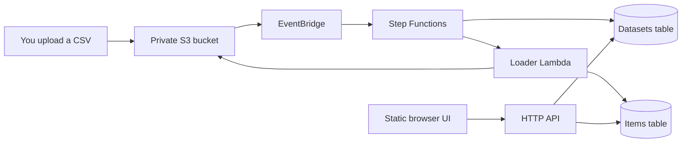

<div align="center">

# DropAPI

### Turn a CSV into a live, filterable API.

Upload a file to S3. DropAPI detects its schema, stores its rows, and makes them available through a REST API — with interactive docs and a plain-English query endpoint.

<br>


</div>

---

## What it does

- **Ingests CSV files** from a private S3 bucket and validates their headers and rows.
- **Infers a schema** for integer, decimal, date, boolean, and string columns.
- **Creates a dataset API** with typed filters, sorting, pagination, and individual-row lookup.
- **Answers simple questions in plain English** by translating them into validated filters — no AI model is involved.
- **Provides a browser UI** for browsing datasets, previewing rows, asking questions, and trying the generated OpenAPI docs.

## How it works



An S3 upload event starts the workflow. Step Functions records the dataset as `PROCESSING`, invokes the loader, and marks it `READY` or `FAILED`. Once ready, the HTTP API serves dataset metadata and rows from DynamoDB.

## Quick start

### Requirements

- An AWS account and configured AWS CLI credentials
- [AWS SAM CLI](https://docs.aws.amazon.com/serverless-application-model/latest/developerguide/install-sam-cli.html)
- AWS CLI v2

### Deploy

```bash
git clone https://github.com/Sayantan-da/Dropapi.git
cd Dropapi
sam build
sam deploy --guided
```

The included `samconfig.toml` defaults to stack `dropapi` in `ap-south-1`. The template creates an S3 bucket, two DynamoDB tables, two Lambda functions, a Step Functions state machine, and an HTTP API. Review the resources and costs for your AWS account before deploying.

After deployment, get the bucket name and API URL from the stack outputs:

```bash
aws cloudformation describe-stacks \
  --stack-name dropapi \
  --region ap-south-1 \
  --query "Stacks[0].Outputs" \
  --output table
```

### Upload a CSV

Use the `UploadBucketName` output from the previous command:

```bash
aws s3 cp samples/clean_sales.csv \
  s3://<UploadBucketName>/uploads/clean_sales.csv \
  --region ap-south-1
```

The dataset ID comes from the file name: this example creates `clean_sales`. Processing is asynchronous; check `GET /datasets` until its status is `READY`.

The CSV must be UTF-8, have a header row with unique non-empty column names, and contain at least one data row. Current limits are **10 MiB**, **50,000 rows**, and **100 columns**. Filenames may use letters, numbers, hyphens, and underscores, and must start with a letter or number.

## API

Set `API_URL` to the `ApiUrl` stack output, then try these endpoints:

| Endpoint | Description |
| --- | --- |
| `GET /` | Service information and route list |
| `GET /datasets` | List datasets and processing status |
| `GET /datasets/{id}` | Dataset metadata and inferred schema |
| `GET /{id}/items` | Filter and page through rows |
| `GET /{id}/items/{key}` | Fetch one row by its inferred primary key |
| `GET /{id}/ask?q=...` | Turn a plain-English question into a query |
| `GET /{id}/openapi.json` | OpenAPI specification for a dataset |

```bash
curl "$API_URL/datasets"
curl "$API_URL/datasets/clean_sales"
curl "$API_URL/clean_sales/items?city=Kolkata&limit=5"
curl "$API_URL/clean_sales/items?price__gte=100&sort=price&order=desc"
curl --get "$API_URL/clean_sales/ask" \
  --data-urlencode "q=top 3 by price"
```

Filters use a column name for equality by default, or an operator suffix such as `price__gte=100`. Supported operators depend on the inferred column type: numeric and date columns support comparisons; strings support equality, `contains`, and `begins_with`; booleans support equality. Results default to 50 rows and can be limited to 100. The `/openapi.json` endpoint can be loaded in Swagger UI to explore a dataset interactively.

## Browser UI

`frontend/index.html` is a static, single-file UI. It lists datasets, shows inferred columns and sample rows, offers suggested questions, and embeds Swagger UI. Before using it with your own deployment, update the API URL and upload-bucket command in the page to match your stack outputs.

## Repository layout

```text
frontend/             Static browser UI
samples/              Example CSV datasets
src/api/              HTTP API and question-to-filter parser
src/load/             CSV validation, schema inference, and row loading
src/scripts/           Benchmark helper
statemachine/          Step Functions ingestion workflow
template.yaml          AWS SAM infrastructure
test-app/              Standalone SAM sample application
```

## Security

The S3 bucket blocks public access, but **the HTTP API has no authentication configured** and returns dataset data to callers. Do not upload sensitive or confidential data. Add authentication and authorization before using this stack with private datasets or in production.

## Remove the stack

Empty the upload bucket first, then delete the stack. Emptying the bucket permanently deletes its objects:

```bash
aws s3 rm s3://<UploadBucketName> --recursive --region ap-south-1
sam delete --stack-name dropapi --region ap-south-1
```
